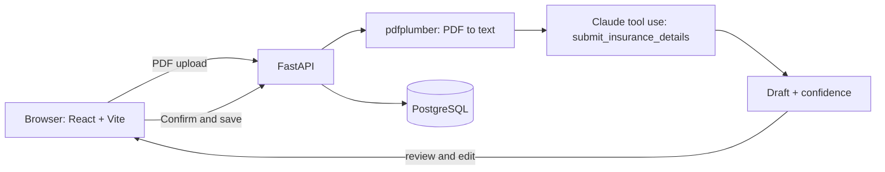
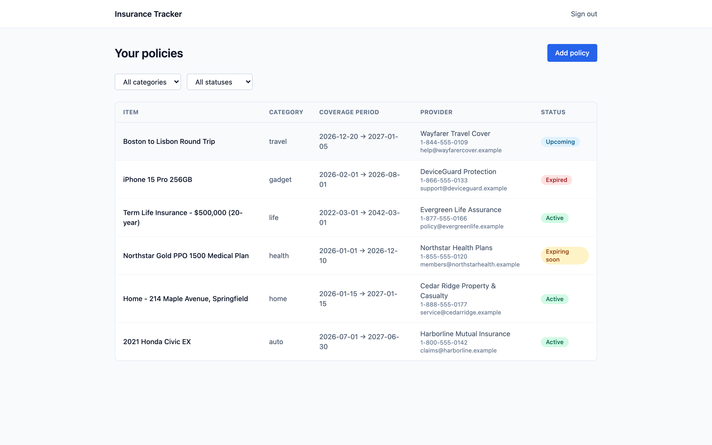
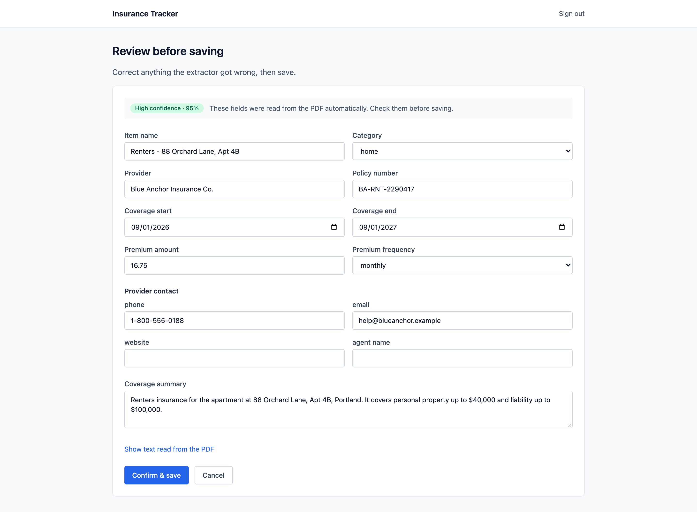
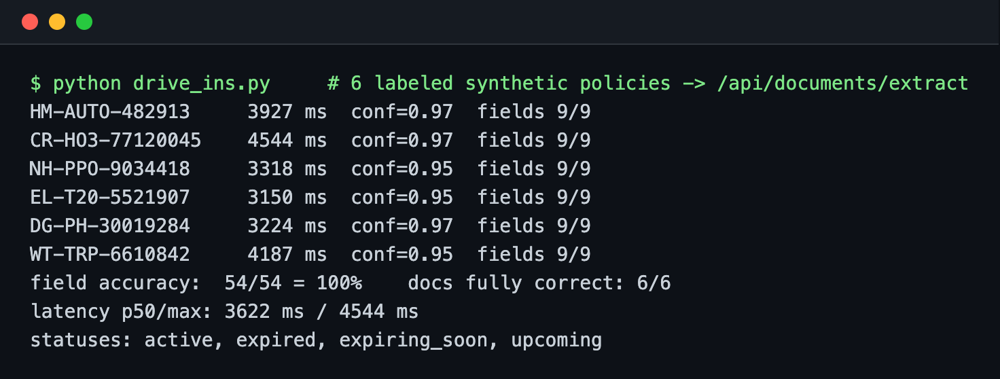

# Insurance Tracker

AI-powered **document intelligence** app that turns insurance policy PDFs into a structured, searchable dashboard. Upload a PDF; **Claude tool-use with a strict JSON schema** extracts the policy details; you review and confirm before anything is saved (**human-in-the-loop**).

> **Keywords:** document AI / intelligent document processing (IDP) · structured extraction · LLM tool use · JSON-schema-constrained output · human-in-the-loop · confidence scoring · FastAPI · async SQLAlchemy · PostgreSQL · Alembic migrations · JWT auth · argon2 · React · TypeScript · Docker

## Highlights

- **100% field-level extraction accuracy (54/54 fields)** on a labeled test set of 6 policies spanning auto, home, health, life, gadget and travel — policy number, provider, coverage dates, premium amount/frequency and contact details — at roughly **3 seconds per document**.
- **Review-before-save workflow:** extraction never writes to the database directly; a confidence-scored draft is shown in an editable form first.

> Measured on a labeled *synthetic* set — see [Methodology](#methodology--honest-caveats).

## Tech stack

| Layer | Technologies |
|---|---|
| Backend | Python 3.11+, **FastAPI**, **SQLAlchemy 2 (async)**, **Alembic**, Pydantic v2 |
| AI extraction | **Anthropic Claude** tool use (`strict` JSON schema, forced tool choice), `pdfplumber` PDF-to-text |
| Database | **PostgreSQL 16** |
| Auth & security | Email + password (**argon2**), **JWT** bearer tokens, per-user data scoping on every query |
| Frontend | **React**, **Vite**, **TypeScript**, Tailwind CSS, `react-dropzone` |
| Infra | **Docker Compose**, Nginx |

## Architecture



## Screenshots

*Synthetic sample policies; no real policy data.*







## Quick start

Requires Docker. Neither Node nor Postgres need to be installed locally.

```bash
cp .env.example .env
```

Edit `.env` (git-ignored): set `ANTHROPIC_API_KEY`, a random `JWT_SECRET_KEY` (`openssl rand -hex 32`) and a `POSTGRES_PASSWORD`. Then:

```bash
docker compose up --build
```

- Frontend: http://localhost:3000
- API docs: http://localhost:8000/docs

The backend runs `alembic upgrade head` on start. All ports bind to `127.0.0.1` by default. The app refuses to start if `JWT_SECRET_KEY` is missing or shorter than 32 characters.

**Frontend dev server:** `cd frontend && npm install && npm run dev` (Vite proxies `/api` to `localhost:8000`).

## How extraction works

`POST /api/documents/extract` stores the PDF, extracts its text, and asks Claude to call a `submit_insurance_details` tool whose schema is strict (`additionalProperties: false`, nullable fields, enumerated categories). The prompt instructs the model to use `null` rather than invent values. The response is returned as an unsaved **draft** with a confidence score; only **Confirm & save** issues `POST /api/items`. A manual-entry path opens the same form blank.

## API

| Method | Path | Purpose |
|---|---|---|
| POST | `/api/auth/signup` · `/api/auth/login` | Create account / sign in, returns a JWT |
| GET | `/api/auth/me` | Current user |
| POST | `/api/documents/extract` | Upload a PDF, get an unsaved draft |
| GET | `/api/items?category=&status=` | List your policies |
| GET / PATCH / DELETE | `/api/items/{id}` | Read, update (sets `last_verified`), delete |
| POST | `/api/items` | Create from a reviewed draft or manual entry |
| GET | `/api/items/{id}/document` | Download the original PDF |

## Data model notes

- `status` is **computed on read**, never stored: `active`, `upcoming` (coverage not started yet), `expiring_soon` (≤ 30 days), `expired`, `unknown` (no start date). The pure function lives in `backend/app/insurance/status.py`.
- Provider contact and premium are stored as flat typed columns so downstream features (e.g. a Q&A bot) can use plain indexed queries.
- Uploaded PDFs live at `uploads/{user_id}/{uuid}.pdf`; unconfirmed uploads are not yet cleaned up.

## Configuration

| Variable | Default | Notes |
|---|---|---|
| `ANTHROPIC_API_KEY` | — | Required for extraction |
| `JWT_SECRET_KEY` | — | **Required**, ≥ 32 random characters |
| `POSTGRES_PASSWORD` | — | **Required** by Docker Compose |
| `CLAUDE_MODEL` | `claude-opus-5` | Any current model ID |
| `DATABASE_URL` | set by Compose | Required when running the backend outside Docker |
| `UPLOADS_DIR` | `./uploads` | Bind-mounted volume in Docker |
| `MAX_UPLOAD_MB` | `20` | Larger PDFs are rejected |

## Methodology & honest caveats

- [`benchmarks/run_benchmark.py`](benchmarks/run_benchmark.py) generates 6 clean synthetic policy PDFs with known ground truth, runs them through the real API, and compares 9 fields per document.
- The documents are clean, single-page specimens and the ground truth was written by the author, so this demonstrates the pipeline end to end rather than real-world accuracy. Scanned or messy policies are not covered (scanned PDFs are rejected with a clear message).
- The recorded run used a local Claude-CLI-backed stand-in for the Anthropic API, so latency is illustrative.

## Security notes

Secrets come from the environment only; `.env` is git-ignored and excluded from Docker images. Passwords are hashed with argon2, every query is scoped by `user_id`, uploads are size-limited, and the Postgres/API/frontend ports bind to localhost. Put the app behind HTTPS and a reverse proxy before exposing it.

## Roadmap

Email ingestion, Telegram upload and a Telegram Q&A bot are planned; the data model already carries `source_channel` values for them.
